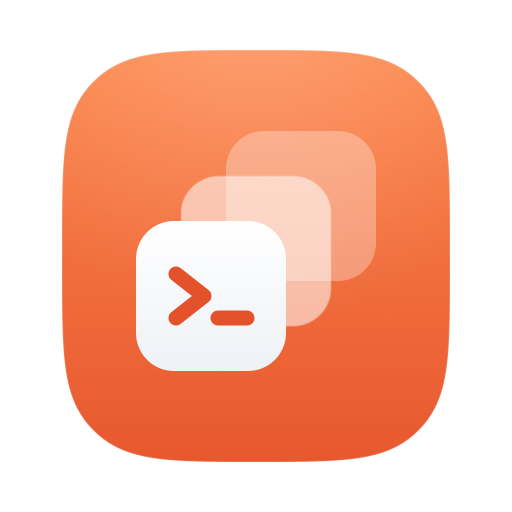
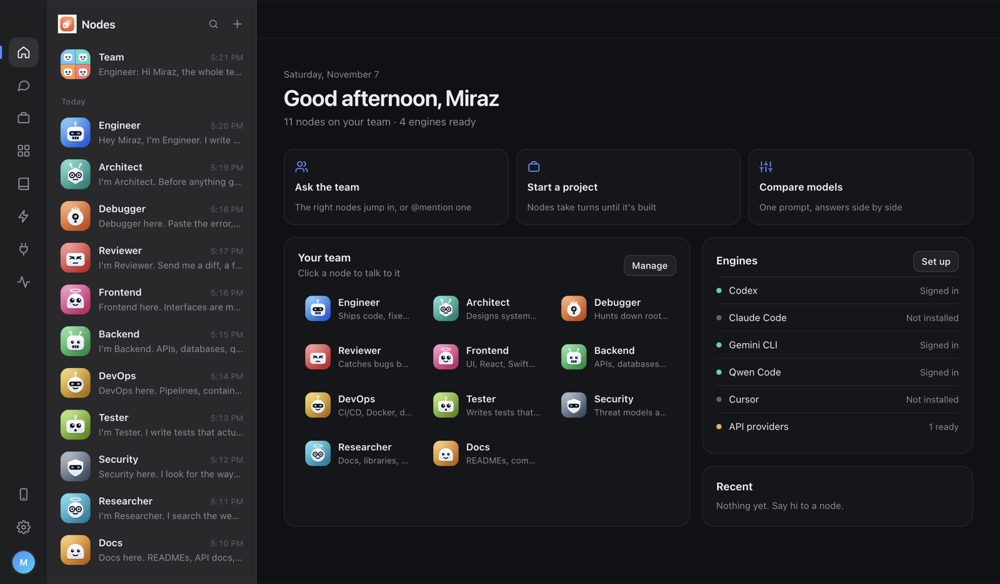
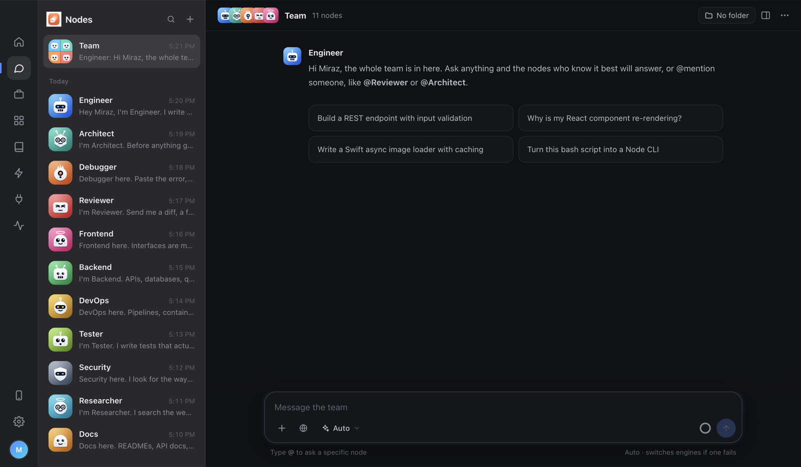
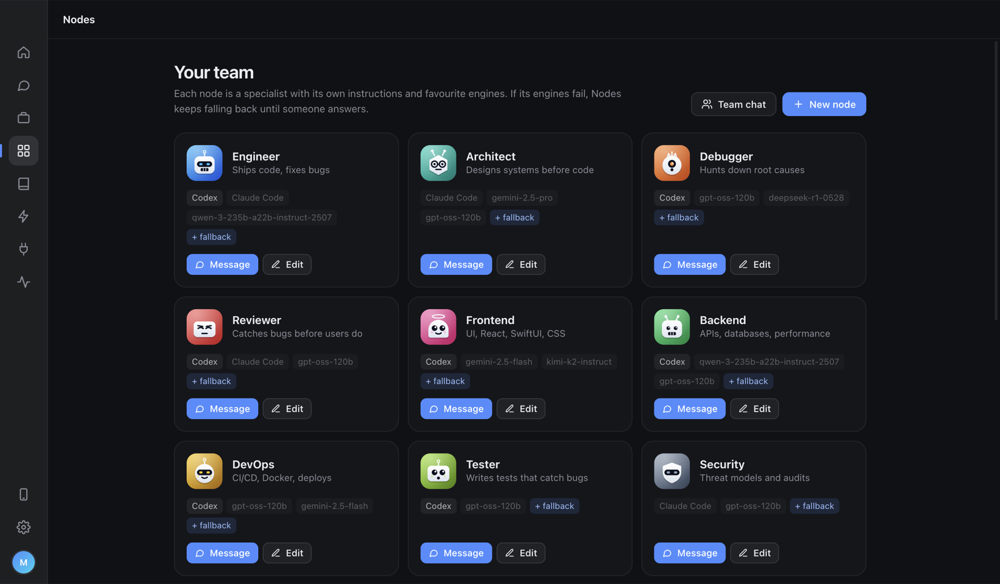

<div align="center">
  
  <h1>Nodes</h1>
  <p>A team of AI engineers on your computer that runs on every model you have, and never stops answering.</p>

  <a href="https://github.com/mirazbakis/Nodes/releases"></a>
  <a href="https://github.com/mirazbakis/Nodes/releases"></a>
  <a href="LICENSE"></a>
  
  

  <br /><br />
  
</div>

## Features

- **A team, not a chatbot.** 11 coding specialists (Engineer, Architect, Debugger, Reviewer, Frontend, Backend, DevOps, Tester, Security, Researcher, Docs), each with its own chat, personality and robot. There's an optional business pack too: Sales, Marketing, Finance, Support, Contracts, Product, Analyst and Hiring.
- **Every AI in one place.** Use the subscriptions you already have through **Codex**, **Claude Code**, **Gemini CLI**, **Qwen Code**, **Cursor** and **OpenCode**, plus around 20 API providers (Gemini, Groq, Cerebras, OpenRouter, Mistral, GitHub Models, NVIDIA, Hugging Face, OpenAI, Anthropic, xAI, DeepSeek and more) and local models through Ollama or LM Studio.
  - Pick the model for each chat, just like any AI app, or leave it on Auto.
  - Works with zero setup: a free model that needs no sign-up is always there as a backup.
- **Automatic fallback.** If a model is rate-limited, out of quota, slow or down, the next one answers. You get a small note, not an error. When an engine is running low, Nodes warns you before it runs out.
- **Team chat.** One group chat with every node. The right ones answer on their own, or you can `@mention` someone.
- **Projects.** Give a goal to a team of nodes. They take turns, each one doing its part and handing its progress to the next, until it's done. Point them at a folder and coding agents work on real files.
  - **Pair mode:** two engines, such as Codex and Gemini CLI, pass work back and forth on one task.
  - **Compare:** one prompt, several models, answers side by side.
- **Real web search.** A hidden built-in browser searches Google or Bing with no key, or you can use Brave, Tavily, Serper, Exa or SearXNG. Nodes reads the top pages and cites them, and there's a browser panel right next to the chat.
- **MEMORY.txt.** One plain text file every node reads, so you never repeat yourself. Edit it in the app or in any editor.
- **Use it from your phone.** Scan a QR code and chat from your phone over your Wi-Fi. No account, no cloud, no database.
- **Built for work.** Template library, scheduled automations, ⌘K / Ctrl+K command palette, secrets hidden before anything leaves your computer, a local-only mode, backups, a context meter and per-engine stats.
- Open source and free.

<div align="center">
  
  
</div>

## Download

Visit [releases](https://github.com/mirazbakis/Nodes/releases) and get the latest version for your computer.

**macOS:** get the `.dmg` (`arm64` for Apple silicon, `x64` for Intel), open it and drag **Nodes** to Applications. On first launch macOS may block it because it isn't notarized. Open **System Settings › Privacy & Security** and click **Open Anyway**.

**Windows:** get `Nodes-…-x64-setup.exe` (or `arm64` for Windows on ARM) and run it, or grab `Nodes-…-portable.exe` to run it without installing. SmartScreen may warn because the app isn't signed: click **More info** › **Run anyway**.

## Building

```bash
git clone https://github.com/mirazbakis/Nodes.git
cd Nodes
npm install
npm start          # run in development
npm run dist       # macOS: build .dmg and .zip into dist/
npm run dist:win   # Windows: build the installer and portable .exe into dist/
```

Every push to `main` builds both versions and publishes them as a release for the `version` in `package.json`.

## Acknowledgements

- [Electron](https://www.electronjs.org/) - The app shell.
- [marked](https://github.com/markedjs/marked) - Markdown rendering.
- [DOMPurify](https://github.com/cure53/DOMPurify) - Keeps rendered replies safe.
- [highlight.js](https://highlightjs.org/) - Code highlighting.
- [node-qrcode](https://github.com/soldair/node-qrcode) - Pairing QR codes for the phone app.
- [Pollinations](https://pollinations.ai/) - The free model and image generation that work with no key.
- Every provider with a free tier, for making this possible without paying a cent.

## License

This project is licensed under the MIT License. See the [LICENSE](LICENSE) file for details. Do whatever you want with it, just keep the copyright notice.
